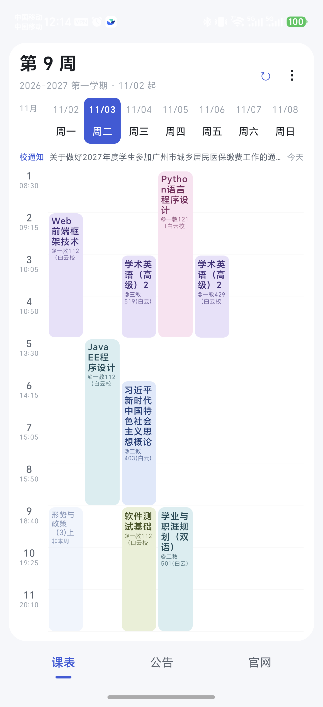
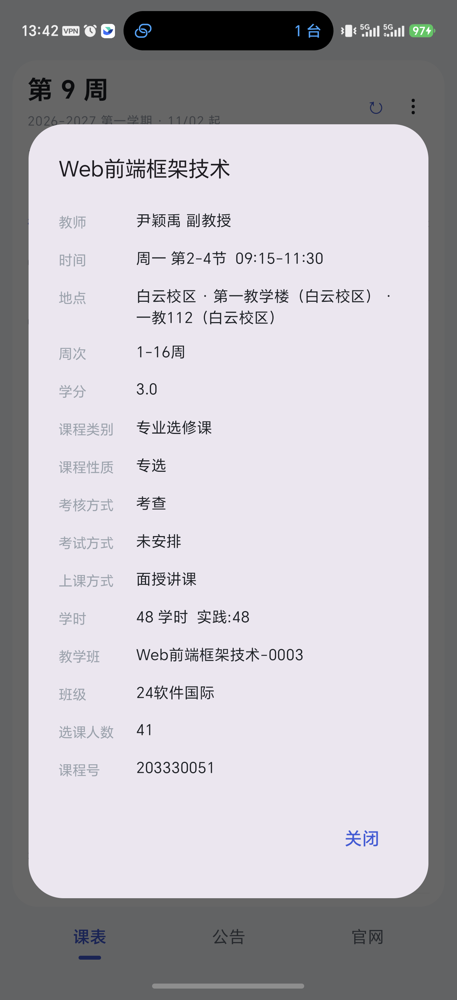
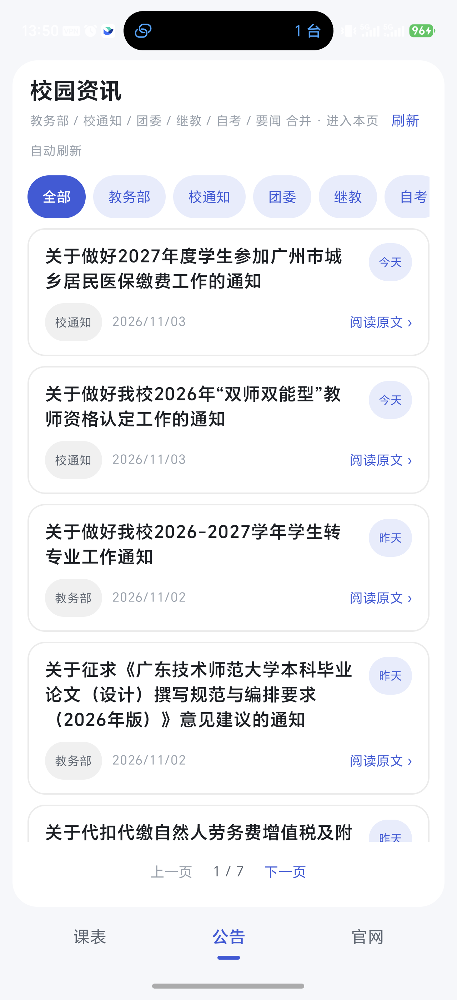
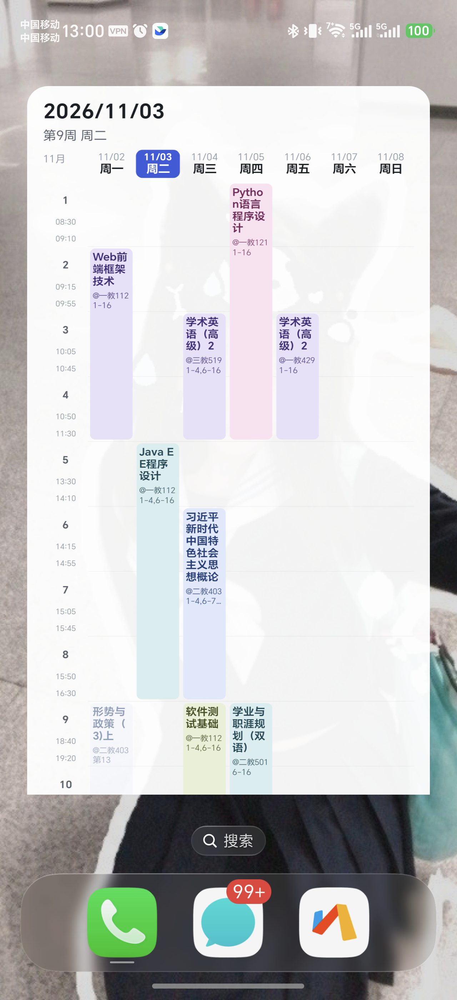

# 轻课表 · Lite Schedule

广东技术师范大学（正方教务）的极简课表 App。无广告、无账号、无云同步，数据全部留在自己的手机里。

不想用带广告和会员的商业课表 App，就自己写了一个。

## 功能

- **周课表**：左右滑动切周，今天高亮，非本周的课淡化标注
- **自动同步**：定时从教务拉课表，发现调课 / 换教室 / 换老师会发通知
- **自动校准周次**：从教务部公开通知里读「正式上课时间」，不用手动填第几周
- **课程详情**：点课程看学分、教师、职称、考核方式、学时、教学班、选课人数等
- **校园资讯**：合并教务部 / 学校通知 / 团委 / 继教 / 自考 / 要闻六个来源，可筛选、可分页
- **官网入口**：教务系统、美育平台、图书馆、邮箱等一键跳转
- **桌面小组件**：整周课表，可上下滚动，非本周的课标「非本周」

## 截图

| 课表 | 课程详情 |
|---|---|
|  |  |

| 校园资讯 | 桌面小组件 |
|---|---|
|  |  |

## 下载

到 [Releases](../../releases) 下载最新 APK 安装即可（Android 8.0 及以上）。

装好后按提示登录一次教务，登录态保存在本机，之后会自动续期。

## 隐私

- 登录态（cookie）只保存在 App 的私有目录，不上传任何服务器
- 没有统计、没有埋点、没有广告 SDK
- 卸载或清除数据后需要重新登录

## 自己编译

需要 JDK 17 和 Android SDK（compileSdk 35）。

```bash
cd android
./gradlew assembleDebug      # 调试包
./gradlew assembleRelease    # 发布包（需 android/keystore.properties）
```

发布签名用 `android/keystore.properties` 配置：

```properties
storeFile=../keystore/your.jks
storePassword=******
keyAlias=your-alias
keyPassword=******
```

没有这个文件时，release 会退回 debug 签名。

## 目录

```
android/       安卓工程（Kotlin + Jetpack Compose）
parser/        正方课表解析脚本（Node，桌面端验证用）
tools/         抓取 / 同步 / 差异对比脚本
```

## 说明

个人项目，与学校官方无关。数据来自学校公开教务系统，请合理使用，不要高频请求。

## License

[MIT](LICENSE)
